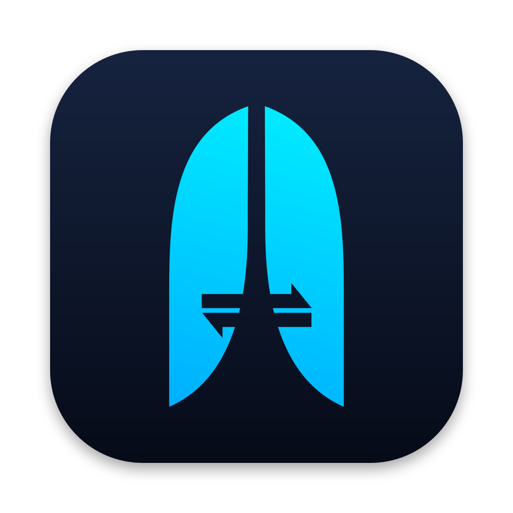
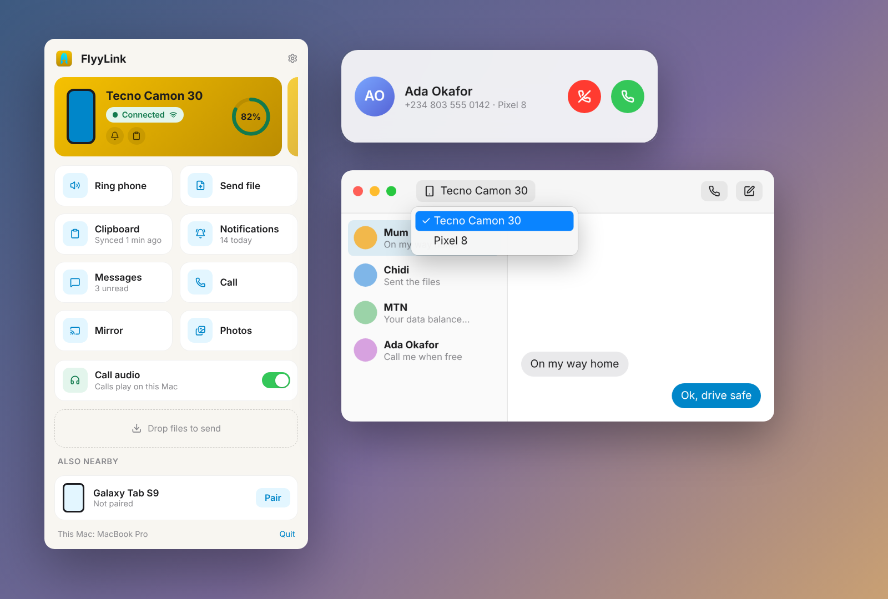

<p align="center">
  
</p>

<h1 align="center">Aproid</h1>

<p align="center"><strong>Your Android phone and your computer, finally on speaking terms.</strong></p>

<p align="center">For Android, Mac and Windows. Free, no account.</p>

---



## What it does

- **Notifications.** Reply from your keyboard.
- **Texts and calls.** Read, reply, answer.
- **Files.** Any size, from any app.
- **FlyyDrop.** Send to anyone nearby.
- **Screen mirroring.** Use your phone from your computer.
- **Photos.** Your latest shots, on your computer.
- **Clipboard.** Copy on one, paste on the other.
- **Find your phone.** Ring it, even on silent.
- **Media and battery.** Play, pause, skip, and check the battery.
- **Several devices.** Pair as many phones and computers as you like.
- **No shared Wi-Fi?** Connects through your phone's hotspot.

## Privacy

No servers, no account, no tracking. Your devices talk to each other directly, encrypted.

## Get it

Download from [aproid.toneflix.com](https://aproid.toneflix.com/#download).

| | Needs | How it installs |
| --- | --- | --- |
| **Android** | Android 8.0 or later | APK, Google Play coming soon |
| **Mac** | macOS 13 Ventura or later | Signed app, updates itself |
| **Windows** | Windows 10 (1809) or later | Installer, updates itself |

### Setting up

1. Put your phone and computer on the same Wi-Fi, or join your phone's hotspot.
2. Open Aproid on both.
3. Tap **Pair** and check the code matches.
4. On the phone, allow notification access and any extras you want.

If the connection drops when the phone is idle (common on Tecno, Infinix, itel and Xiaomi), let Aproid run in the background in your battery settings.

Close KDE Connect while setting up; both use the same network port.

## For developers

Aproid is three native apps sharing one protocol.

| Folder | What's inside |
| --- | --- |
| `android/protocol` | The protocol in plain Kotlin: packets, identity, pairing, discovery. |
| `android/app` | The Android app (Kotlin, Jetpack Compose). |
| `macos/Sources/AproidKit` | The protocol in Swift. |
| `macos/Sources/Aproid` | The Mac menu bar app (SwiftUI). |
| `windows/src/Aproid.Core` | The protocol in C#. |
| `windows/src/Aproid` | The Windows tray app (WinUI 3). |
| `web` | The website (Next.js). |
| `branding` | The logo and the scripts that generate every app icon. |
| `docs` | [Architecture](docs/ARCHITECTURE.md) and [roadmap](docs/ROADMAP.md). |

**Android** (JDK 17 and the Android SDK):

```sh
cd android
./gradlew :protocol:test        # protocol tests, no Android SDK needed
./gradlew :app:installDebug     # build and install on a connected phone
```

**Mac** (Xcode 15 or later):

```sh
cd macos
swift test
./scripts/bundle.sh             # builds macos/build/Aproid.app
open build/Aproid.app
```

Run it as a bundle, or notifications and the Share menu won't work.

**Windows** (.NET 8 SDK, and Windows for the app itself):

```sh
cd windows
dotnet test tests/Aproid.Core.Tests    # runs on any OS
```

See [windows/README.md](windows/README.md) for building the app and the installer.

**Website** (Node 20 or later):

```sh
cd web
npm install
npm run dev
```

### Releasing

Push a tag like `1.2.3` to release all three apps, or `android-1.2.3`, `macos-1.2.3`, `windows-1.2.3` for one. The workflow uploads the files to the website, which serves the download links and both computer apps' update feeds. `.github/workflows/release.yml` lists the secrets.

## License

Proprietary. © Toneflix Technologies Limited. See [LICENSE](LICENSE).
