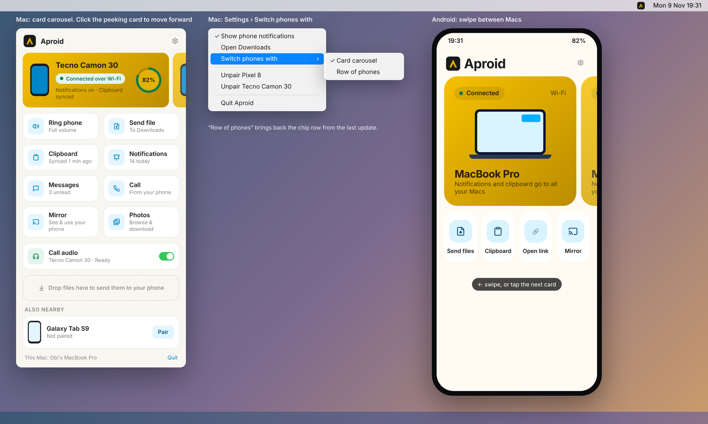

<p align="center">
  
</p>

<h1 align="center">Aproid</h1>

<p align="center"><strong>Your Android phone and your computer, finally on speaking terms.</strong></p>

<p align="center">For Android, Mac and Windows. Free, and nothing leaves your own network.</p>

---

iPhone owners get a quiet little luxury: their phone and their Mac just work together. A text arrives and they answer it from the laptop. A photo goes from pocket to desktop in a second. The phone rings in the other room and they pick up from where they're sitting.

If you carry an Android phone, you've mostly had to do without. Aproid fixes that. Install it on your phone and your computer, pair them once, and they'll work together like they came in the same box.


## What it does

**Notifications.** Your phone's notifications pop up on your computer, app icon and all. Reply to a WhatsApp message from your keyboard, or clear a notification on the computer and it's gone from the phone too.

**Texts and calls.** Read and answer your SMS in a proper Messages window. When the phone rings, you'll see who it is and can pick up or decline right there. On a Mac you can even talk through the Mac's speakers and mic. That part is still new, so expect the odd hiccup.

**Files.** Drop a file on Aproid, use the Share menu, or share from any app on your phone. A big video that gets cut off halfway carries on from where it stopped.

**Screen mirroring.** See your phone in a window on your computer, with sound, and use it with your mouse and keyboard. Great for the apps that only live on your phone.

**Photos.** Your latest photos and screenshots are right there on the computer. Grab the ones you want. On Windows they also show up in File Explorer.

**Clipboard.** Copy on one, paste on the other. Text, pictures, even files.

**Finding your phone.** Lost it in the sofa again? Make it ring from your computer, at full volume, even if it's on silent. If it's not in the house, see where it was last on a map.

**And the rest.** Battery level at a glance, a heads up when it's running low, and play, pause and skip for whatever's playing on the phone.

**Several phones, several computers.** Got a work phone and a personal one? Pair both. Got a Mac at home and a PC at work? Pair the phone with each. You can pair your computers with each other too, to pass files and links back and forth, share a clipboard and control the music on the other one.

**No Wi-Fi? Still works.** On a hotel or café network that won't let devices see each other, Aproid finds your phone over Bluetooth and connects through your phone's hotspot instead.



## Your stuff stays yours

There's no Aproid server, no account to make and nothing tracking you. Your phone and your computer talk straight to each other over your own network or Bluetooth, and everything they send is encrypted. A device can only connect after you've paired it and checked the same code on both screens. Your texts, photos and notifications never go anywhere but your own devices.

## Get it

Download the latest version for each platform from the [Releases page](https://github.com/toneflix/aproid/releases).

| | Needs | How it installs |
| --- | --- | --- |
| **Android** | Android 8.0 or later | APK, Google Play coming soon |
| **Mac** | macOS 13 Ventura or later | Signed app, updates itself |
| **Windows** | Windows 10 (1809) or later | Installer, updates itself |

### Setting up

1. Put your phone and computer on the same Wi-Fi (or turn on your phone's hotspot and join it).
2. Open Aproid on both. Each one shows the other within a few seconds.
3. Tap **Pair**, check the code matches on both screens, and accept.
4. On the phone, allow notification access and whichever extras you want (messages, calls, screen control). Aproid explains each one when you turn it on.

Some phones, especially Tecno, Infinix, itel and Xiaomi models, close background apps aggressively. If the connection drops when you put the phone away, let Aproid run in the background in your phone's battery settings.

Using KDE Connect as well? Close it while you set up Aproid, because the two apps compete for the same network port.

## For developers

Aproid is three native apps sharing one protocol.

| Folder | What's inside |
| --- | --- |
| `android/protocol` | The protocol in plain Kotlin: packets, identity, pairing, discovery. |
| `android/app` | The Android app (Kotlin, Jetpack Compose). |
| `macos/Sources/AproidKit` | The protocol in Swift. |
| `macos/Sources/Aproid` | The Mac menu bar app (SwiftUI). |
| `windows/src/Aproid.Core` | The protocol in C#. |
| `windows/src/Aproid` | The Windows tray app (WinUI 3). |
| `web` | The website (Next.js). |
| `branding` | The logo and the scripts that generate every app icon. |
| `docs` | [Architecture](docs/ARCHITECTURE.md) and [roadmap](docs/ROADMAP.md). |

**Android** (JDK 17 and the Android SDK):

```sh
cd android
./gradlew :protocol:test        # protocol tests, no Android SDK needed
./gradlew :app:installDebug     # build and install on a connected phone
```

**Mac** (Xcode 15 or later):

```sh
cd macos
swift test
./scripts/bundle.sh             # builds macos/build/Aproid.app
open build/Aproid.app
```

Run it as a bundle. Without one, macOS won't show notifications or the Share menu entry.

**Windows** (.NET 8 SDK, and Windows for the app itself):

```sh
cd windows
dotnet test tests/Aproid.Core.Tests    # runs on any OS
```

See [windows/README.md](windows/README.md) for building the app and the installer.

**Website** (Node 20 or later):

```sh
cd web
npm install
npm run dev
```

### Releasing

Push a version tag such as `1.2.3` and `.github/workflows/release.yml` builds and publishes all three apps in one release. Use `android-1.2.3`, `macos-1.2.3` or `windows-1.2.3` to release a single app. The signing secrets each app needs are listed at the top of the workflow.

## License

MIT. See [LICENSE](LICENSE).
